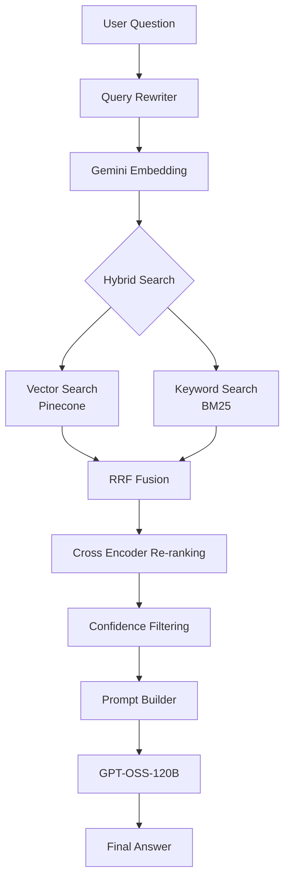
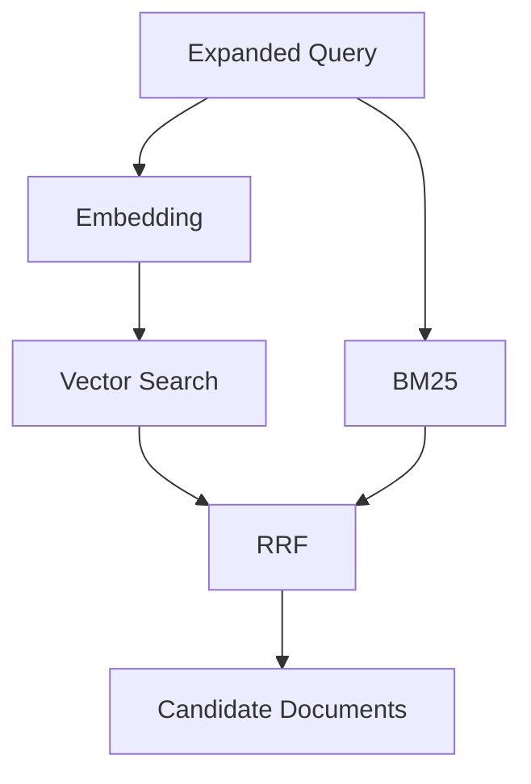
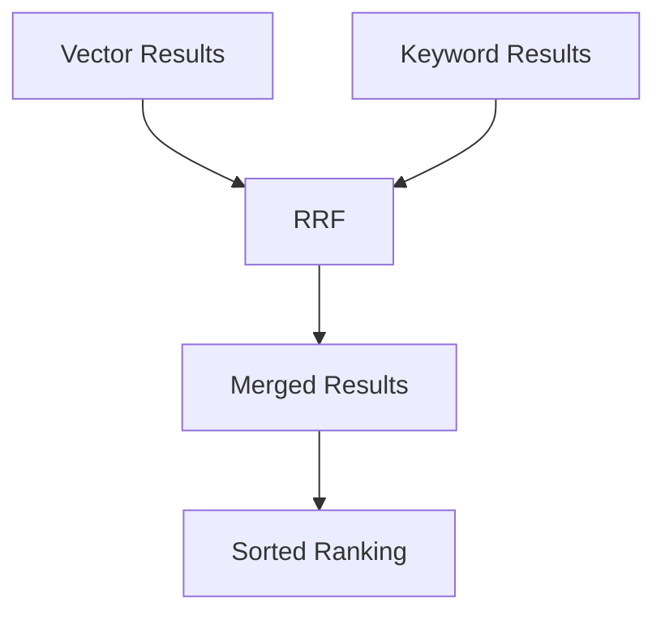
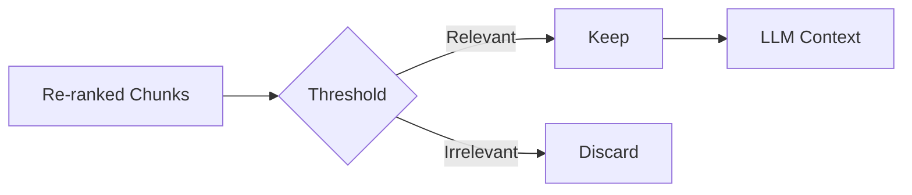
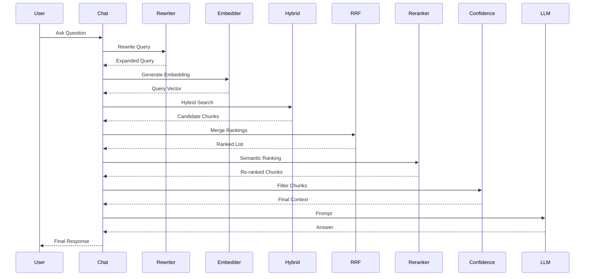
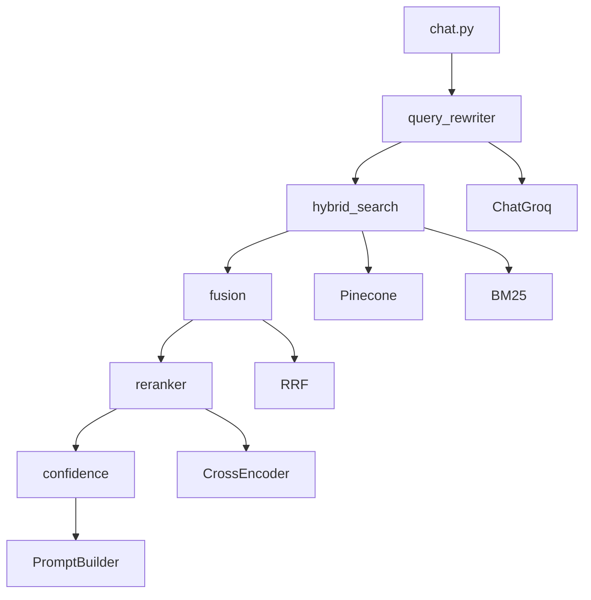
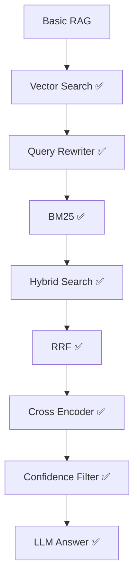

# 🚀 Advanced RAG Pipeline using Pinecone, Gemini, Hybrid Search & Re-Ranking

<p align="center">


</p>

---

# 📖 Project Overview

This project demonstrates how to build an **Advanced Retrieval-Augmented Generation (RAG)** system from scratch using a modular architecture.

Instead of relying on a basic vector search, this project progressively improves retrieval quality by integrating multiple retrieval and ranking techniques commonly used in production AI systems.

The pipeline combines:

- Semantic Search (Dense Vector Retrieval)
- Keyword Search (BM25)
- Hybrid Search
- Reciprocal Rank Fusion (RRF)
- Query Rewriting
- Cross-Encoder Re-ranking
- Confidence Filtering

to provide highly relevant context before sending it to the Large Language Model (LLM).

The entire project is organized into independent modules, making it easy to understand, maintain, and extend.

---

# 🎯 Project Goals

The primary objective of this project is to understand how modern Retrieval-Augmented Generation systems work internally instead of relying on pre-built frameworks.

This repository focuses on:

- Learning production-level RAG architecture
- Building every retrieval component separately
- Keeping every module reusable
- Understanding why each component exists
- Improving retrieval accuracy step-by-step
- Creating an interview-ready Advanced RAG project

---

# ✨ Features Implemented

## Core RAG

- ✅ Document Ingestion
- ✅ Markdown Document Support
- ✅ PDF Document Support
- ✅ Metadata Storage
- ✅ Source Tracking
- ✅ Chunking
- ✅ Embedding Generation
- ✅ Pinecone Vector Database

---

## Retrieval

- ✅ Dense Vector Search
- ✅ BM25 Keyword Search
- ✅ Hybrid Search
- ✅ Reciprocal Rank Fusion (RRF)

---

## Retrieval Enhancement

- ✅ Query Rewriting
- ✅ Cross Encoder Re-ranking
- ✅ Confidence Filtering

---

## LLM

- ✅ GPT-OSS-120B (Groq)
- ✅ Strict Context-based Prompting
- ✅ Hallucination Reduction

---

## Engineering

- ✅ Modular Folder Structure
- ✅ Independent Components
- ✅ Easy Testing
- ✅ Debug Friendly Output

---

# 🏗 Current Architecture

```

                 Documents
                     │
                     ▼
              Document Loader
                     │
                     ▼
                Chunking
                     │
                     ▼
                Embeddings
                     │
                     ▼
                 Pinecone
                     │
                     ▼
──────────────────────────────────────────
                 User Query
                     │
                     ▼
             Query Rewriter
                     │
                     ▼
          Query Embedding Generation
                     │
         ┌───────────┴────────────┐
         ▼                        ▼
 Vector Search              BM25 Search
         │                        │
         └───────────┬────────────┘
                     ▼
          Reciprocal Rank Fusion
                     ▼
              Cross Encoder
               Re-ranking
                     ▼
          Confidence Filtering
                     ▼
              Prompt Builder
                     ▼
             GPT-OSS-120B
                     ▼
               Final Answer

```

---

# 🛠 Technology Stack

| Category | Technology |
|-----------|------------|
| Language | Python |
| Vector Database | Pinecone |
| Embedding Model | Gemini Embedding 001 |
| LLM | GPT-OSS-120B (Groq) |
| Framework | LangChain |
| Keyword Retrieval | BM25 |
| Re-ranking | Cross Encoder |
| Configuration | python-dotenv |

---

# 📂 Current Folder Structure

```

advanced-rag/
│
├── confidence/
│
├── fusion/
│
├── hybrid_search/
│
├── query_rewriter/
│
├── reranker/
│
├── test/
│
├── data/
│
├── create_index.py
├── ingest.py
├── chat.py
├── requirements.txt
└── README.md

```

Each folder contains a single independent module responsible for one task in the RAG pipeline.

This modular approach makes the project easy to maintain, debug, and extend with new retrieval techniques.

---

# 🚀 Development Progress

| Module | Status |
|----------|--------|
| Basic RAG | ✅ Completed |
| Pinecone Integration | ✅ Completed |
| Markdown Chunking | ✅ Completed |
| Query Rewriter | ✅ Completed |
| Vector Retrieval | ✅ Completed |
| BM25 Retrieval | ✅ Completed |
| Hybrid Search | ✅ Completed |
| Reciprocal Rank Fusion | ✅ Completed |
| Cross Encoder Re-ranking | ✅ Completed |
| Confidence Filtering | ✅ Completed |
| Source Metadata | ✅ Completed |

---

# 📌 Next Documentation Sections

The following sections will be added in the next phases of this documentation:

- Project Setup
- Installation Guide
- Environment Variables
- Execution Flow
- create_index.py
- ingest.py
- chat.py
- Query Rewriter
- Hybrid Search
- Reciprocal Rank Fusion
- Re-ranking
- Confidence Filtering
- Prompt Engineering
- Interview Questions
- Future Roadmap

---

# ⚙️ Getting Started

This section explains how to set up the project on your local machine from scratch.

---

# 📋 Prerequisites

Before running this project, make sure the following software is installed.

| Software | Version |
|-----------|---------|
| Python | 3.10+ (Recommended: 3.12) |
| Git | Latest |
| Pinecone Account | Required |
| Google AI Studio Account | Required |
| Groq Account | Required |

---

# 📥 Clone the Repository

Clone the repository from GitHub.

```bash
git clone https://github.com/<your-username>/advanced-rag.git

cd advanced-rag
```

---

# 🐍 Create Virtual Environment

It is recommended to use a virtual environment.

Windows

```bash
python -m venv .venv
```

Activate

```bash
.venv\Scripts\activate
```

Linux / macOS

```bash
python3 -m venv .venv
```

Activate

```bash
source .venv/bin/activate
```

---

# 📦 Install Dependencies

Install all required packages.

```bash
pip install -r requirements.txt
```

If you update any package, regenerate the requirements file.

```bash
pip freeze > requirements.txt
```

---

# 🔑 Create Environment Variables

Create a file named

```
.env
```

inside the project root.

Example:

```env
PINECONE_API_KEY=your_pinecone_api_key

GEMINI_API_KEY=your_gemini_api_key

GROQ_API_KEY=your_groq_api_key
```

> **Important**
>
> Never commit your `.env` file to GitHub.

---

# 📁 Required Data Folder

Place your documents inside the **data** directory.

Example

```
data/

├── safety_manual.pdf
├── hr_policy.pdf
├── environment_policy.md
```

Supported formats

- Markdown (.md)
- PDF (.pdf)

---

# 📦 Install Models

This project uses the following AI models.

## Embedding Model

```
Google Gemini Embedding

models/gemini-embedding-001
```

Used for

- Document Embeddings
- Query Embeddings

---

## LLM

```
GPT-OSS-120B
```

Provider

```
Groq
```

Used for

- Query Expansion
- Final Answer Generation

---

## Cross Encoder

Current model

```
cross-encoder/ms-marco-MiniLM-L-6-v2
```

Used for

- Re-ranking retrieved chunks

---

# 📦 Required Python Libraries

Major libraries used in this project.

| Library | Purpose |
|----------|----------|
| LangChain | LLM Framework |
| Pinecone | Vector Database |
| rank-bm25 | Keyword Search |
| sentence-transformers | Cross Encoder Re-ranking |
| python-dotenv | Environment Variables |
| google-generativeai | Gemini Embeddings |
| langchain-google-genai | LangChain Gemini Integration |
| langchain-groq | Groq Integration |

---

# ▶️ Running the Project

The project should always be executed in the following order.

```
Step 1

python create_index.py
```

↓

```
Step 2

python ingest.py
```

↓

```
Step 3

python chat.py
```

Do **not** run `chat.py` before completing the ingestion process.

---

# 📌 Why This Execution Order?

The pipeline depends on the output of the previous step.

```
create_index.py
```

Creates the Pinecone index.

↓

```
ingest.py
```

Generates embeddings and uploads document chunks into Pinecone.

↓

```
chat.py
```

Retrieves relevant chunks from Pinecone and generates answers.

Skipping any step will result in retrieval errors.

---

# ✅ Verify Installation

You can verify your setup by running:

```bash
python create_index.py
```

Expected output

```
Index already exists.
```

or

```
Index created successfully.
```

Then run

```bash
python ingest.py
```

Expected output

```
Ingestion Completed
```

Finally

```bash
python chat.py
```

Example

```
Ask Question:

What PPE rules are mentioned?
```

If you receive an answer from the model, the setup has been completed successfully.

---

# 🛑 Common Setup Issues

### ModuleNotFoundError

Run the project from the root directory.

Correct

```bash
python chat.py
```

Incorrect

```bash
cd test

python test_keyword.py
```

Instead use

```bash
python -m test.test_keyword
```

---

### Missing API Key

Ensure that the `.env` file exists and contains all required API keys.

---

### Empty Search Results

Possible reasons

- Index not created
- Documents not ingested
- Wrong namespace
- Incorrect API key

---

### Cross Encoder Downloads Every Time

The model is downloaded only once and then cached locally.

The first run may take a little longer.

# 🔄 Project Execution Flow

Once the project has been installed and configured, it follows a fixed execution pipeline.

Every stage depends on the output of the previous stage.

```
                ┌────────────────────────────┐
                │     create_index.py        │
                └─────────────┬──────────────┘
                              │
                              ▼
                ┌────────────────────────────┐
                │        ingest.py           │
                └─────────────┬──────────────┘
                              │
                              ▼
                ┌────────────────────────────┐
                │         chat.py            │
                └─────────────┬──────────────┘
                              │
                              ▼
                    User asks a Question
                              │
                              ▼
                    Query Rewriter Module
                              │
                              ▼
                    Query Embedding Model
                              │
             ┌────────────────┴────────────────┐
             ▼                                 ▼
      Vector Search                     Keyword Search
        (Pinecone)                          (BM25)
             │                                 │
             └──────────────┬──────────────────┘
                            ▼
                Reciprocal Rank Fusion
                            ▼
                    Cross Encoder
                      Re-ranking
                            ▼
                  Confidence Filtering
                            ▼
                     Prompt Builder
                            ▼
                     GPT-OSS-120B
                            ▼
                     Final Answer
```

---

# Step 1 — Create Pinecone Index

Run

```bash
python create_index.py
```

---

## Purpose

The purpose of this script is to create the Pinecone vector index that will later store all document embeddings.

This script normally needs to be executed only once.

If the index already exists, it simply exits without creating a duplicate.

---

## Responsibilities

- Connect to Pinecone
- Authenticate using API Key
- Check whether the index already exists
- Create a new index if required
- Configure vector dimensions
- Configure similarity metric

---

## Main Packages Used

| Package | Purpose |
|----------|----------|
| Pinecone | Vector Database |
| dotenv | Load API Keys |
| os | Read Environment Variables |

---

## Input

```
.env
```

Contains

```
PINECONE_API_KEY
```

---

## Output

```
Pinecone Index
```

Example

```
simple-rag-md
```

---

## Data Flow

```
API Key

↓

Connect to Pinecone

↓

Check Existing Index

↓

Create Index

↓

Ready for Ingestion
```

---

# Step 2 — Document Ingestion

Run

```bash
python ingest.py
```

---

## Purpose

This script prepares all documents for retrieval.

Instead of uploading raw documents into Pinecone, the documents are first transformed into semantic chunks.

Each chunk is converted into an embedding vector before being uploaded.

---

## Responsibilities

- Load documents
- Split documents into chunks
- Preserve metadata
- Generate embeddings
- Upload vectors to Pinecone

---

## Main Packages Used

| Package | Purpose |
|----------|----------|
| TextLoader | Markdown Loader |
| PyPDFLoader | PDF Loader |
| MarkdownHeaderTextSplitter | Semantic Markdown Chunking |
| RecursiveCharacterTextSplitter | Fixed-size Chunking |
| GoogleGenerativeAIEmbeddings | Generate Embeddings |
| Pinecone | Upload Vectors |

---

## Complete Ingestion Pipeline

```
Document

↓

Load Document

↓

Markdown Header Split

↓

Recursive Chunking

↓

Metadata

↓

Gemini Embeddings

↓

Upload to Pinecone
```

---

## Metadata Stored

Every uploaded chunk stores metadata.

Example

```
Source File

Page Number

Chunk ID
```

This metadata is later used for

- Source Citation
- Filtering
- Debugging

---

## Output

```
Chunk 1

Embedding

Metadata

↓

Pinecone
```

Repeated for every chunk.

---

# Step 3 — Start the Chat Pipeline

Run

```bash
python chat.py
```

---

## Purpose

This script performs the complete Advanced RAG pipeline.

It accepts the user's question, retrieves relevant information from Pinecone, improves retrieval quality using multiple retrieval techniques, and finally generates the answer using the LLM.

---

## High-Level Flow

```
User Question

↓

Query Rewriter

↓

Embedding

↓

Hybrid Search

↓

RRF

↓

Re-ranking

↓

Confidence

↓

Prompt Builder

↓

LLM

↓

Answer
```

---

## Modules Called

During execution, `chat.py` orchestrates multiple independent modules.

| Module | Responsibility |
|----------|----------------|
| query_rewriter | Expand user query |
| hybrid_search | Retrieve documents |
| fusion | Merge retrieval results |
| reranker | Improve ranking |
| confidence | Remove low-quality chunks |
| LLM | Generate final response |

---

## Why Modular Design?

Instead of placing all logic inside `chat.py`, every responsibility is separated into an independent module.

Advantages

- Easier debugging
- Reusable code
- Cleaner architecture
- Better testing
- Production-ready design

---

## Pipeline Responsibility

The responsibility of `chat.py` is **not** to implement every algorithm.

Its responsibility is only to orchestrate the complete pipeline.

Each algorithm lives inside its own dedicated module.

This keeps the codebase clean, scalable, and easy to extend.

---

# What Happens Next?

After `chat.py` starts, the pipeline enters multiple intelligent retrieval stages.

These stages are documented separately in the following sections.

1. Query Rewriter
2. Hybrid Search
3. Reciprocal Rank Fusion
4. Cross Encoder Re-ranking
5. Confidence Filtering
6. Prompt Builder
7. LLM

# 🧠 Module 1 — Query Rewriter

---

## Why Query Rewriting?

Users often ask short, incomplete, or ambiguous questions.

For example

```
PPE rules
```

Although humans understand this means **Personal Protective Equipment Rules**, a vector database only sees a few words.

Because of this, important chunks may never be retrieved.

Query rewriting solves this problem by expanding the original question into a richer semantic query before retrieval.

---

## Folder Structure

```
query_rewriter/
│
├── __init__.py
└── query_rewriter.py
```

---

## Responsibility

This module performs **Query Expansion**.

It improves retrieval by generating:

- Synonyms
- Related terms
- Expanded wording
- Alternative expressions

without changing the original meaning of the user's question.

---

## Position in Pipeline

```
User Question

↓

Query Rewriter

↓

Embedding

↓

Hybrid Search
```

---

## Input

Example

```
What PPE rules are mentioned?
```

---

## Output

```
What PPE rules are mentioned?

personal protective equipment

PPE guidelines

safety regulations

protective equipment requirements

workplace safety rules
```

The expanded query is then converted into an embedding and passed to the retrieval system.

---

## Internal Flow

```
Original Question

↓

Prompt Template

↓

GPT-OSS-120B

↓

Expanded Query

↓

Return to chat.py
```

---

## Why use an LLM?

Traditional query expansion relies on:

- Thesaurus
- Manual synonym lists
- Static dictionaries

These approaches are limited.

Using an LLM allows the system to generate context-aware expansions that better match the language used in documents.

---

## Benefits

Query rewriting improves:

- Retrieval Recall
- Semantic Matching
- Synonym Coverage
- Acronym Expansion
- Search Robustness

Example

Original

```
PPE rules
```

Expanded

```
Personal Protective Equipment

Safety Equipment

Protective Gear

Workplace Safety

PPE Regulations
```

Without rewriting, some relevant chunks might never be retrieved.

---

## Libraries Used

| Library | Purpose |
|----------|----------|
| langchain-groq | Connect to Groq |
| ChatGroq | Query Expansion |
| dotenv | Load API Keys |

---

## Main Model

```
GPT-OSS-120B
```

Provider

```
Groq
```

---

## Prompt Strategy

The prompt instructs the LLM to:

- Preserve the original meaning
- Expand only relevant concepts
- Avoid answering the question
- Return only the rewritten query

The objective is **better retrieval**, not answer generation.

---

## Example

Original Query

```
Pregnancy leave
```

Expanded Query

```
Pregnancy leave

Maternity leave

Employee maternity policy

Paid maternity leave

Pregnancy-related leave

Leave benefits

Parental leave
```

Notice that the rewritten query introduces multiple related terms while preserving the user's intent.

---

## Why This Improves Hybrid Search

Hybrid Search consists of

```
Vector Search

+

BM25 Keyword Search
```

Both retrievers benefit from a richer query.

### Vector Search

Semantic similarity improves because the embedding contains more context.

### BM25

Exact keyword matching improves because more relevant keywords are present.

Thus, a single rewritten query improves both retrieval methods simultaneously.

---

## Debug Output

During execution, the module prints:

```
================================================================================

QUERY EXPANSION

================================================================================

Original Query

...

Expanded Query

...
```

This makes debugging much easier and allows developers to inspect the rewritten query before retrieval begins.

---

## Future Improvements

Possible future enhancements include:

- Multi-query generation
- HyDE (Hypothetical Document Embeddings)
- Query decomposition
- Automatic spelling correction
- Domain-specific query rewriting
- Self-RAG query refinement

---

## Summary

The Query Rewriter is the first intelligent component of the retrieval pipeline.

Instead of searching using the user's raw question, the system first expands the query into a richer semantic representation.

This significantly improves retrieval quality while keeping the overall architecture modular and easy to extend.

# 🔍 Module 2 — Hybrid Search

---

## Why Hybrid Search?

Traditional RAG systems rely only on **Dense Vector Search**.

Although semantic search is powerful, it sometimes fails when the user searches using:

- Exact words
- Acronyms
- Product codes
- IDs
- Numbers
- Short queries
- Rare keywords

On the other hand, keyword search (BM25) performs extremely well for exact lexical matching but completely ignores semantic meaning.

Instead of choosing one retrieval method, this project combines both.

This approach is known as **Hybrid Search**.

---

# Hybrid Search Architecture

```

                    User Query
                         │
                         ▼
                  Query Embedding
                         │
        ┌────────────────┴────────────────┐
        ▼                                 ▼
 Vector Search                     Keyword Search
   (Pinecone)                           (BM25)
        │                                 │
        └────────────────┬────────────────┘
                         ▼
               Reciprocal Rank Fusion
                         ▼
                 Final Retrieved Chunks

```

---

# Folder Structure

```
hybrid_search/
│
├── __init__.py
├── retrieval_document.py
├── vector_retriever.py
├── keyword_retriever.py
└── hybrid_retriever.py
```

Each file is responsible for one specific retrieval task.

This keeps the retrieval pipeline modular and easy to extend.

---

# Workflow

```
User Query

↓

Generate Embedding

↓

Vector Retrieval

↓

Keyword Retrieval

↓

Merge Results

↓

Return to chat.py
```

---

# File 1 — retrieval_document.py

---

## Purpose

This file defines a common data structure that is shared across every retrieval module.

Instead of passing multiple dictionaries around the project, every retriever returns the same object.

This greatly simplifies merging, debugging, and ranking.

---

## Stored Information

Each retrieved document contains

- Document ID
- Content
- Source
- Page Number
- Vector Score
- BM25 Score
- RRF Score
- Retriever Name

Example

```
Retriever : hybrid

Vector Score : 0.81

BM25 Score : 2.45

RRF Score : 0.032
```

---

## Why is this useful?

Without a common document object,

Vector Search

↓

Dictionary

Keyword Search

↓

Another Dictionary

Fusion

↓

Another Dictionary

The code quickly becomes difficult to maintain.

Using one standard object keeps every module consistent.

---

# File 2 — vector_retriever.py

---

## Responsibility

Retrieve semantically similar chunks from Pinecone.

---

## Data Source

```
Pinecone Vector Database
```

---

## Search Method

```
Dense Vector Search
```

---

## Internal Flow

```
User Query

↓

Embedding

↓

Pinecone

↓

Top K Chunks

↓

RetrievalDocument
```

---

## Returned Information

Each result contains

- Content
- Vector Score
- Metadata
- Retriever = vector

---

## Advantages

- Semantic understanding
- Finds similar meaning
- Handles paraphrases
- Works well with natural language

---

## Limitations

Vector Search may fail when searching

```
Employee ID

PPE

ISO 14001

Policy Number

Specific Keywords
```

because semantic similarity is different from exact word matching.

---

# File 3 — keyword_retriever.py

---

## Responsibility

Retrieve documents using traditional keyword search.

---

## Search Algorithm

```
BM25
```

---

## Important Design Decision

Unlike Vector Search,

BM25 **does NOT search Pinecone**.

Instead, it searches the locally stored document chunks.

```
Document Chunks

↓

Tokenization

↓

BM25 Index

↓

Keyword Search

↓

RetrievalDocument
```

---

## Why?

BM25 is a lexical retrieval algorithm.

It requires

- Words
- Frequencies
- Positions

instead of embeddings.

Therefore BM25 operates directly on text.

---

## Libraries Used

```
rank-bm25
```

---

## Returned Information

Each result contains

- Content
- BM25 Score
- Metadata
- Retriever = keyword

---

## Advantages

BM25 performs extremely well for

- Exact keywords
- Acronyms
- Product names
- IDs
- Numbers
- Technical terminology

---

## Example

Query

```
PPE
```

BM25 immediately matches

```
PPE
```

whereas semantic search may prioritize

```
Personal Protective Equipment
```

depending on embeddings.

---

# File 4 — hybrid_retriever.py

---

## Responsibility

Run both retrieval methods independently.

This file does **not** perform ranking.

It simply collects results.

---

## Internal Flow

```
Expanded Query

↓

Generate Embedding

↓

Vector Retriever

↓

Keyword Retriever

↓

Return Both Lists
```

---

## Why Separate?

Many beginners believe

```
Hybrid Search

↓

Vector Search

↓

Keyword Search on Vector Results
```

This is **incorrect**.

In this project,

both retrieval systems execute independently.

```
                 Query
                    │
       ┌────────────┴────────────┐
       ▼                         ▼
Vector Search             BM25 Search
       │                         │
       └────────────┬────────────┘
                    ▼
             Reciprocal Rank Fusion
```

This is how production Hybrid Search systems work.

---

# Why Not Search BM25 on Vector Results?

That approach would ignore many relevant documents.

For example

```
100 documents

↓

Vector Search

↓

Top 5

↓

BM25
```

BM25 can only search inside those 5 documents.

The remaining 95 documents are ignored.

Instead,

BM25 searches the **entire corpus independently**.

This greatly improves recall.

---

# Hybrid Search Benefits

By combining both retrieval strategies,

the system benefits from

- Semantic understanding
- Exact keyword matching
- Better recall
- Better precision
- Higher robustness

---

# Debug Output

During execution,

the following information is displayed.

```
Rank 1

Retriever : hybrid

Vector Score : 0.82

BM25 Score : 2.41

RRF Score : 0.0317
```

This makes it easy to understand

- which retriever found the document,
- how strong each score is,
- and how the final ranking was produced.

---

# Future Improvements

Possible future enhancements include

- Metadata Filtering
- Sparse Embeddings
- Hybrid Scoring
- Dynamic Weighting
- Multi-stage Retrieval
- Multi-query Retrieval
- Parent Document Retrieval
- Multi Vector Retrieval

---

# Summary

The Hybrid Search module is responsible for retrieving candidate documents using two independent retrieval strategies.

Instead of relying solely on semantic similarity, the system combines dense vector retrieval with lexical BM25 retrieval.

The results from both retrievers are then forwarded to the Reciprocal Rank Fusion module, where they are merged into a single ranked candidate list before re-ranking.

# 🔀 Module 3 — Reciprocal Rank Fusion (RRF)

---

# Why Do We Need RRF?

After Hybrid Search, we have **two independent ranked lists**.

One comes from

- Dense Vector Search

The other comes from

- BM25 Keyword Search

Example

Vector Search

| Rank | Document |
|------|----------|
| 1 | Chunk A |
| 2 | Chunk B |
| 3 | Chunk C |

Keyword Search

| Rank | Document |
|------|----------|
| 1 | Chunk C |
| 2 | Chunk D |
| 3 | Chunk A |

Now the question becomes

> **Which ranking should we trust?**

Should we trust Vector Search?

Or BM25?

The answer is

**Neither.**

Instead, we combine both rankings.

This process is called

**Reciprocal Rank Fusion (RRF).**

---

# What is RRF?

Reciprocal Rank Fusion is a ranking algorithm that combines multiple ranked lists into a single ranking.

Unlike score averaging,

RRF completely ignores the original retrieval scores.

Instead,

it only considers **the rank position** of every document.

---

# Why Ignore Scores?

This is an extremely important design decision.

Consider this example.

Vector Search

```
Chunk A

Similarity = 0.82
```

BM25

```
Chunk A

Score = 3.91
```

These numbers are

- Different scales
- Different algorithms
- Different meanings

They cannot be compared directly.

Therefore,

adding them together would be mathematically incorrect.

---

# The RRF Formula

The score of a document is calculated as

```
           1
---------------------
(k + rank)
```

where

- **rank** = document position
- **k** = constant (usually 60)

If the same document appears in multiple retrieval lists,

their RRF scores are added together.

---

# Example

Suppose

Vector Search returns

| Rank | Document |
|------|----------|
| 1 | A |
| 2 | B |
| 3 | C |

BM25 returns

| Rank | Document |
|------|----------|
| 1 | C |
| 2 | A |
| 3 | D |

Using

```
k = 60
```

Vector

```
A = 1 / 61

B = 1 / 62

C = 1 / 63
```

BM25

```
C = 1 / 61

A = 1 / 62

D = 1 / 63
```

Final

```
A = 1/61 + 1/62

B = 1/62

C = 1/63 + 1/61

D = 1/63
```

Notice that

Chunk **A**

appeared twice.

Its score automatically increases.

---

# Why Is This Better?

Suppose both retrieval systems independently believe

```
Chunk A
```

is relevant.

Then

it should receive a higher final rank.

RRF naturally rewards this agreement.

---

# Position in Pipeline

```
Vector Search

+

BM25

↓

Reciprocal Rank Fusion

↓

Re-ranking
```

---

# Folder Structure

```
fusion/

├── __init__.py
└── rrf.py
```

---

# Responsibility

The RRF module

- receives Vector Search results
- receives BM25 results
- merges duplicate documents
- computes RRF score
- returns one ranked list

---

# Internal Workflow

```
Vector Results

↓

Dictionary

↓

BM25 Results

↓

Merge Documents

↓

Calculate RRF Score

↓

Sort

↓

Return Final Ranking
```

---

# Duplicate Handling

Suppose

Vector Search finds

```
Chunk 18
```

BM25 also finds

```
Chunk 18
```

Instead of returning

```
Chunk 18

Chunk 18
```

the module merges both into

```
Chunk 18

Vector Score

BM25 Score

RRF Score

Retriever = hybrid
```

Only one document is returned.

---

# Retriever Labels

After merging,

each document is automatically assigned a retriever type.

| Retriever | Meaning |
|-----------|----------|
| vector | Found only by Vector Search |
| keyword | Found only by BM25 |
| hybrid | Found by both retrievers |

Example

```
Retriever : hybrid

Vector Score : 0.81

BM25 Score : 2.43

RRF Score : 0.032
```

This information is extremely useful for debugging.

---

# Why Not Average Scores?

Many beginners try

```
Final Score

=

Vector Score

+

BM25 Score
```

This is incorrect because

Vector Score

```
0.81
```

and BM25

```
3.91
```

have completely different meanings.

There is no mathematical relationship between them.

RRF avoids this problem entirely.

---

# Advantages

RRF offers several important benefits.

- No score normalization required
- Works with different retrieval algorithms
- Simple to implement
- Robust in practice
- Widely used in Information Retrieval
- Excellent for Hybrid Search

---

# Debug Output

During execution,

the project prints

```
Rank 1

Retriever : hybrid

Vector Score : 0.82

BM25 Score : 2.44

RRF Score : 0.03252
```

This allows developers to inspect

- original retriever
- individual retrieval scores
- final RRF score

before re-ranking begins.

---

# Current Project Flow

```
User Query

↓

Query Rewriter

↓

Embedding

↓

Vector Search

+

BM25

↓

Reciprocal Rank Fusion

↓

Cross Encoder Re-ranking

↓

Confidence Filtering

↓

LLM
```

---

# Future Improvements

Possible future enhancements

- Weighted RRF
- Sparse + Dense Fusion
- Metadata-aware Fusion
- Multi-Retriever Fusion
- Time-aware Ranking
- Personalized Retrieval Fusion

---

# Interview Questions

### Why not simply average Vector and BM25 scores?

Because both algorithms use different scoring systems.

Their scores are not directly comparable.

RRF solves this by using document rank instead of score.

---

### Why does RRF use rank instead of score?

Rank is algorithm-independent.

Every retriever can produce a ranked list,

even if their score distributions are completely different.

---

### Why is RRF used before Re-ranking?

RRF combines multiple retrieval strategies into one candidate list.

The Cross Encoder then performs a much more expensive semantic ranking only on those candidate documents.

This keeps the pipeline efficient.

---

# Summary

The Reciprocal Rank Fusion module is responsible for intelligently combining multiple retrieval results into a single ranked candidate list.

Instead of comparing incompatible retrieval scores, it uses rank positions to produce a robust ranking.

This merged list becomes the input for the Cross Encoder Re-ranking module, which further improves retrieval quality before the context is sent to the LLM.

# 🎯 Module 4 — Cross Encoder Re-ranking

---

# Why Do We Need Re-ranking?

After Hybrid Search and Reciprocal Rank Fusion (RRF), we already have a ranked list of candidate documents.

However, retrieval algorithms are designed to **retrieve** relevant documents, not necessarily to **rank them perfectly**.

For example, after Hybrid Search we may obtain:

| Rank | Document |
|------|----------|
| 1 | PPE Equipment |
| 2 | Environmental Policy |
| 3 | PPE Rules |
| 4 | Employee Responsibilities |

The user asked:

```
What PPE rules are mentioned?
```

Although "Environmental Policy" appears near the top, it is clearly less relevant than "PPE Rules".

This is where the Cross Encoder comes into the pipeline.

---

# Position in Pipeline

```
Vector Search

+

BM25 Search

↓

Reciprocal Rank Fusion

↓

Cross Encoder Re-ranking

↓

Confidence Filtering

↓

LLM
```

---

# Folder Structure

```
reranker/
│
├── __init__.py
└── reranker.py
```

---

# Responsibility

The Re-ranking module is responsible for:

- Evaluating every retrieved document against the user's query.
- Assigning a semantic relevance score.
- Sorting documents according to their relevance.
- Passing only the most relevant chunks to the Confidence module.

Unlike retrieval algorithms, the Cross Encoder **reads both the query and the document together** before assigning a score.

---

# What is a Cross Encoder?

A Cross Encoder is a Transformer model that receives:

```
(Query, Document)
```

as a single input sequence.

Example

```
Question:

What PPE rules are mentioned?

↓

Document:

Wear required PPE before starting work...
```

The model jointly processes both texts and predicts how relevant the document is to the query.

---

# Cross Encoder vs Bi-Encoder

## Bi-Encoder (Embedding Model)

```
Query

↓

Embedding

Document

↓

Embedding

↓

Cosine Similarity
```

Advantages

- Extremely fast
- Scalable
- Suitable for millions of documents

Disadvantages

- Documents and queries are encoded independently.
- Some semantic relationships may be missed.

---

## Cross Encoder

```
Query

+

Document

↓

Transformer

↓

Relevance Score
```

Advantages

- Reads query and document together.
- Much higher ranking accuracy.
- Better understanding of context.

Disadvantages

- Computationally expensive.
- Not suitable for searching millions of documents directly.

Therefore, it is only used on a **small set of retrieved candidates**.

---

# Why Use Re-ranking?

Suppose Hybrid Search returns:

| Rank | Document |
|------|----------|
| 1 | Environmental Policy |
| 2 | PPE Rules |
| 3 | Safety Manual |

Although "Environmental Policy" appears first, it may only contain a few matching keywords.

The Cross Encoder understands that:

```
PPE Rules
```

is semantically much closer to the user's question.

It reorders the list accordingly.

---

# Internal Workflow

```
Candidate Documents

↓

For each document

↓

(Query, Document)

↓

Cross Encoder

↓

Relevance Score

↓

Sort by Score

↓

Return Ranked Documents
```

---

# Model Used

Current model

```
cross-encoder/ms-marco-MiniLM-L-6-v2
```

This model is widely used for passage ranking and provides an excellent balance between speed and accuracy.

---

# Libraries Used

| Library | Purpose |
|----------|----------|
| sentence-transformers | Cross Encoder |
| torch | Model Inference |

---

# Score Interpretation

Unlike cosine similarity, Cross Encoder scores are **not normalized**.

Typical examples:

```
0.82
```

Very relevant

---

```
0.35
```

Possibly relevant

---

```
-0.40
```

Weak relevance

---

```
-2.30
```

Probably irrelevant

---

```
-8.50
```

Very unlikely to be relevant

---

# Important Note

A **negative score does NOT mean the model is broken**.

The model simply predicts that the document has low semantic relevance to the query.

Only the relative ranking matters.

---

# Example

Before Re-ranking

| Rank | Vector Score |
|------|--------------|
| PPE Equipment | 0.73 |
| Environmental Policy | 0.72 |
| PPE Rules | 0.71 |

After Cross Encoder

| Rank | Cross Score |
|------|-------------|
| PPE Rules | 0.81 |
| PPE Equipment | 0.73 |
| Environmental Policy | -2.84 |

Notice how the most relevant document moves to the top.

---

# Why Not Use Cross Encoder for Retrieval?

Imagine:

```
1,000,000 documents
```

A Cross Encoder would need to evaluate

```
1,000,000
```

(Query, Document) pairs.

This would be extremely slow.

Instead:

```
Vector Search

↓

Top 20 Documents

↓

Cross Encoder

↓

Top 5 Documents
```

Only a small number of documents are evaluated, making the system both fast and accurate.

---

# Debug Output

During execution, the project prints:

```
AFTER RE-RANKING

Rank 1

Cross Encoder Score : 0.7021
```

This allows developers to inspect how the ranking changed after semantic evaluation.

---

# Future Improvements

Possible future enhancements include:

- Larger Cross Encoder models
- GPU acceleration
- Batch inference
- ONNX optimization
- Domain-specific fine-tuned rerankers
- Late Interaction models (e.g., ColBERT)

---

# Interview Questions

### Why use a Cross Encoder after Hybrid Search?

Hybrid Search retrieves candidate documents quickly.

The Cross Encoder then performs a much more accurate semantic ranking on this smaller set.

---

### Why not replace Vector Search with a Cross Encoder?

Because Cross Encoders are computationally expensive.

They are suitable for ranking a few documents, not searching an entire corpus.

---

### Why can Cross Encoder scores be negative?

The model outputs raw relevance logits, not probabilities.

Negative values simply indicate lower semantic relevance.

---

### Why do we perform Re-ranking before Confidence Filtering?

The Confidence module should evaluate the **best semantic ranking**.

Filtering before Re-ranking could accidentally remove documents that would have been promoted by the Cross Encoder.

---

# Summary

The Cross Encoder Re-ranking module is responsible for improving the quality of retrieved documents before they are sent to the LLM.

Unlike embedding-based retrieval, it jointly analyzes the user query and each candidate document, producing a much more accurate relevance score.

This stage significantly improves answer quality while keeping the overall retrieval pipeline efficient by evaluating only a small set of candidate documents.

# 🛡️ Module 5 — Confidence Filtering

---

# Why Do We Need Confidence Filtering?

After Cross Encoder Re-ranking, we have a ranked list of documents.

However, **not every retrieved document should be sent to the LLM**.

Even after re-ranking, some documents may still have very low semantic relevance.

For example:

| Rank | Cross Score | Document |
|------|-------------|----------|
| 1 | 0.82 | PPE Rules |
| 2 | 0.74 | PPE Equipment |
| 3 | 0.12 | Environmental Policy |
| 4 | -1.45 | Employee Benefits |
| 5 | -5.81 | Vacation Policy |

Clearly, the last two documents are unrelated to the user's question.

Sending these chunks to the LLM would introduce noise and increase the chance of hallucinations.

Confidence Filtering solves this problem.

---

# Position in Pipeline

```
Hybrid Search

↓

RRF

↓

Cross Encoder Re-ranking

↓

Confidence Filtering

↓

Prompt Builder

↓

LLM
```

---

# Folder Structure

```
confidence/
│
├── __init__.py
└── confidence.py
```

---

# Responsibility

The Confidence module is responsible for:

- Evaluating Cross Encoder scores
- Removing low-confidence documents
- Building the final context
- Preventing irrelevant chunks from reaching the LLM

This is the **last retrieval stage** before answer generation.

---

# Why Not Send Every Retrieved Chunk?

Suppose we retrieve ten chunks.

Only three are actually relevant.

If all ten are sent to the LLM:

```
Relevant

Relevant

Relevant

Irrelevant

Irrelevant

Irrelevant

...
```

The model receives unnecessary information.

This may lead to:

- Hallucinations
- Confused answers
- Longer prompts
- Higher token usage
- Increased inference cost

Filtering improves both quality and efficiency.

---

# Internal Workflow

```
Re-ranked Documents

↓

Read Cross Encoder Score

↓

Apply Threshold

↓

Keep Relevant Chunks

↓

Discard Weak Chunks

↓

Return Final Context
```

---

# Static Threshold

The simplest approach is a fixed threshold.

Example:

```python
THRESHOLD = 0.50
```

Logic

```
score >= 0.50

↓

Keep
```

```
score < 0.50

↓

Discard
```

---

# Example

| Cross Score | Decision |
|-------------|----------|
| 0.84 | ✅ Keep |
| 0.71 | ✅ Keep |
| 0.55 | ✅ Keep |
| 0.32 | ❌ Remove |
| -1.27 | ❌ Remove |

Only the first three chunks are sent to the LLM.

---

# Why Static Threshold is Not Enough?

A fixed threshold works well in many situations, but it is not always optimal.

Consider two queries.

### Query 1

```
What PPE rules are mentioned?
```

Scores:

```
0.82

0.74

0.69

0.66
```

A threshold of **0.50** works perfectly.

---

### Query 2

```
What are pregnancy-related leave benefits?
```

Scores:

```
0.41

0.37

0.35

0.30
```

Even though these documents are the **best available matches**, a fixed threshold of **0.50** would reject every chunk.

The LLM would receive no context and fail to answer.

---

# Dynamic Threshold

To solve this limitation, the project is designed to support **Dynamic Confidence Thresholding**.

Instead of using a fixed value, the threshold is calculated from the distribution of Cross Encoder scores for the current query.

Possible strategies include:

- Relative to the top score
- Average score
- Percentile-based filtering
- Statistical methods

This allows the system to adapt to different queries automatically.

---

# Current Implementation

At the current stage of the project:

- ✅ Static confidence filtering is implemented.
- 🚧 Dynamic confidence filtering is planned as a future enhancement.

This keeps the implementation simple while providing a clear path for future improvements.

---

# Output

The module returns only the selected chunks.

Example:

```
Chunk 1

PPE Rules
```

```
Chunk 2

PPE Equipment
```

These chunks are concatenated to build the final prompt.

---

# Prompt Builder

The selected chunks become the context supplied to the LLM.

```
Context

↓

Prompt Template

↓

GPT-OSS-120B

↓

Answer
```

Because irrelevant chunks have already been removed, the LLM focuses only on high-quality evidence.

---

# Debug Output

During execution, the project prints the final context:

```
================================================================================

FINAL CONTEXT SENT TO LLM

================================================================================

Chunk 1

Vector Score : 0.73

Cross Score : 0.70

...

Chunk 2

Vector Score : 0.68

Cross Score : 0.68
```

This makes it easy to verify exactly what information was provided to the LLM.

---

# Benefits

Confidence Filtering provides several advantages:

- Reduces hallucinations
- Removes noisy context
- Improves answer quality
- Reduces prompt size
- Saves LLM tokens
- Improves debugging
- Makes the pipeline more reliable

---

# Future Improvements

Possible future enhancements include:

- Dynamic Threshold
- Query-aware Threshold
- Adaptive Confidence Calibration
- Top-N + Threshold Hybrid Selection
- Score Normalization
- Confidence Visualization
- User-configurable Thresholds

---

# Interview Questions

### Why is Confidence Filtering needed?

Not every retrieved document is relevant enough to be passed to the LLM.

Filtering removes weak candidates and improves answer quality.

---

### Why is Confidence Filtering performed after Re-ranking?

The Cross Encoder provides the most accurate semantic relevance scores.

Filtering before Re-ranking could discard documents that would otherwise be promoted.

---

### Why not simply send the Top-K documents?

A Top-K strategy may still include irrelevant chunks.

Confidence Filtering selects documents based on relevance rather than position alone.

---

### What is the difference between Top-K and Threshold Filtering?

**Top-K** always returns a fixed number of documents, even if some are irrelevant.

**Threshold Filtering** returns only documents that satisfy a minimum confidence requirement.

---

### Why is Dynamic Threshold better than Static Threshold?

A fixed threshold assumes every query has the same score distribution.

Dynamic Threshold adapts to the current query, making the system more robust across different search scenarios.

---

# Summary

The Confidence Filtering module is the final quality-control stage of the retrieval pipeline.

It evaluates the semantic relevance scores produced by the Cross Encoder and removes low-confidence documents before prompt construction.

By ensuring that only high-quality evidence reaches the LLM, this module reduces hallucinations, improves answer quality, and keeps the retrieval pipeline efficient and production-ready.

# 📊 Architecture Diagrams

This section provides visual representations of the complete Advanced RAG pipeline.

These diagrams are compatible with **GitHub Mermaid** rendering.

---

# 1️⃣ Complete System Architecture



---

# 2️⃣ Document Ingestion Pipeline


---

# 3️⃣ Retrieval Pipeline


---

# 4️⃣ Hybrid Search



---

# 5️⃣ Query Rewriter


---

# 6️⃣ Reciprocal Rank Fusion



---

# 7️⃣ Cross Encoder Re-ranking


---

# 8️⃣ Confidence Filtering



---

# 9️⃣ End-to-End Data Flow



---

# 🔟 Folder Dependency Diagram



---

# 1️⃣1️⃣ Current Module Status



---

# 📈 Current Pipeline

```
User Question
      │
      ▼
Query Rewriter
      │
      ▼
Gemini Embedding
      │
      ▼
Hybrid Search
      │
      ▼
Reciprocal Rank Fusion
      │
      ▼
Cross Encoder Re-ranking
      │
      ▼
Confidence Filtering
      │
      ▼
Prompt Builder
      │
      ▼
GPT-OSS-120B
      │
      ▼
Final Answer
```


# 🎓 Phase 6.2 — Advanced Retrieval Interview Guide

This section covers the most frequently asked interview questions related to the Advanced Retrieval pipeline implemented in this project.

---

# 📌 Query Rewriting

---

## Q1. What is Query Rewriting?

### Answer

Query Rewriting is the process of transforming a user's original query into a richer and more descriptive query before retrieval.

Instead of changing the user's intent, it expands the query by adding:

- Synonyms
- Related concepts
- Acronym expansions
- Domain-specific terminology

This improves retrieval recall without affecting the meaning of the question.

---

## Q2. Why do we need Query Rewriting?

### Answer

Users usually write short or ambiguous queries.

Example

```
PPE Rules
```

Documents may contain

```
Personal Protective Equipment

Safety Equipment

Protective Gear
```

Without query rewriting, many relevant documents may never be retrieved.

---

## Q3. Does Query Rewriting improve Vector Search only?

### Answer

No.

It improves both:

- Dense Vector Search
- BM25 Keyword Search

The rewritten query contains richer semantics for embeddings and additional keywords for lexical matching.

---

## Q4. Can Query Rewriting generate wrong terms?

### Answer

Yes.

Since it uses an LLM, it may occasionally introduce irrelevant or overly broad terms.

For this reason, prompts should explicitly instruct the model to preserve the original intent.

---

# 📌 Dense Vector Search

---

## Q5. What is Dense Vector Search?

### Answer

Dense Vector Search retrieves documents based on semantic similarity.

Both the query and documents are converted into embeddings, and similarity is measured using vector distance (e.g., cosine similarity).

---

## Q6. What are the advantages of Dense Search?

### Answer

- Understands meaning instead of exact words.
- Handles synonyms and paraphrases.
- Supports natural language queries.
- Works well for semantic retrieval.

---

## Q7. What are the limitations of Dense Search?

### Answer

Dense Search may struggle with:

- Exact IDs
- Product codes
- Acronyms
- Rare technical terms
- Numbers

This is why Hybrid Search combines Dense Search with BM25.

---

# 📌 BM25 Keyword Search

---

## Q8. What is BM25?

### Answer

BM25 is a lexical retrieval algorithm that ranks documents based on keyword frequency and rarity.

Unlike vector search, BM25 works directly on raw text instead of embeddings.

---

## Q9. Why does BM25 search local documents instead of Pinecone?

### Answer

BM25 requires token frequencies and word statistics.

Vector databases store embeddings, not lexical indexes.

Therefore BM25 searches the original text corpus independently.

---

## Q10. What types of queries are ideal for BM25?

### Answer

BM25 performs well on:

- Exact keywords
- IDs
- Product names
- Acronyms
- Error codes
- Numbers

---

# 📌 Hybrid Search

---

## Q11. What is Hybrid Search?

### Answer

Hybrid Search combines:

- Dense Vector Search
- BM25 Keyword Search

Both retrievers execute independently, and their results are merged later.

---

## Q12. Why not perform BM25 only on Vector Search results?

### Answer

Because that would drastically reduce recall.

Example:

```
1000 Documents

↓

Vector Search

↓

Top 5

↓

BM25
```

BM25 would only search those 5 documents and ignore the remaining 995.

Instead, BM25 searches the entire corpus independently.

---

## Q13. Why is Hybrid Search better than Dense Search?

### Answer

Dense Search understands meaning.

BM25 understands exact words.

Hybrid Search combines both strengths, resulting in higher recall and better robustness.

---

## Q14. What is the biggest misconception about Hybrid Search?

### Answer

Many developers think:

```
Vector Search

↓

BM25
```

This is incorrect.

The correct architecture is:

```
Vector Search

+

BM25

↓

Fusion
```

Both retrieval methods run independently.

---

# 📌 Reciprocal Rank Fusion (RRF)

---

## Q15. What problem does RRF solve?

### Answer

Vector Search and BM25 produce separate ranked lists.

RRF merges them into a single ranking without comparing incompatible scores.

---

## Q16. Why not average Vector and BM25 scores?

### Answer

Because the scores come from different algorithms and have different scales.

For example:

```
Vector = 0.82

BM25 = 3.91
```

Adding them has no mathematical meaning.

---

## Q17. What is the RRF formula?

### Answer

```
RRF = Σ 1 / (k + rank)
```

where:

- **rank** = document position
- **k** = constant (typically 60)

---

## Q18. Why does RRF use ranks instead of scores?

### Answer

Ranks are algorithm-independent.

Every retrieval algorithm can produce a ranked list, even if their scoring systems are completely different.

---

# 📌 Cross Encoder Re-ranking

---

## Q19. Why do we need Re-ranking?

### Answer

Retrieval algorithms are optimized for recall, not perfect ranking.

A Cross Encoder performs a deeper semantic comparison and improves the ordering of candidate documents.

---

## Q20. What is the difference between a Bi-Encoder and a Cross Encoder?

### Answer

**Bi-Encoder**

- Encodes query and document separately.
- Fast.
- Used for retrieval.

**Cross Encoder**

- Processes query and document together.
- More accurate.
- Used for re-ranking.

---

## Q21. Why not use a Cross Encoder for retrieval?

### Answer

Because it is computationally expensive.

Searching millions of documents with a Cross Encoder would be impractical.

Instead:

```
Retrieve Top 20

↓

Re-rank Top 20
```

---

## Q22. Why can Cross Encoder scores be negative?

### Answer

Cross Encoder outputs raw relevance logits, not probabilities.

Negative values simply indicate lower semantic relevance.

---

# 📌 Confidence Filtering

---

## Q23. Why is Confidence Filtering required?

### Answer

Not every retrieved document should be sent to the LLM.

Confidence Filtering removes weakly relevant chunks, reducing hallucinations and prompt noise.

---

## Q24. Why perform Confidence Filtering after Re-ranking?

### Answer

The Cross Encoder provides the most reliable semantic relevance scores.

Filtering before re-ranking could discard documents that would otherwise become highly relevant.

---

## Q25. Top-K vs Threshold Filtering?

### Answer

Top-K always returns a fixed number of documents.

Threshold Filtering returns only documents whose relevance exceeds a minimum confidence level.

Threshold Filtering usually produces cleaner context.

---

## Q26. Static vs Dynamic Threshold?

### Answer

**Static Threshold**

- Fixed value.
- Simple to implement.
- May fail across diverse queries.

**Dynamic Threshold**

- Adapts to score distribution.
- More robust.
- Better suited for production systems.

---

# 📌 End-to-End Pipeline

---

## Q27. Explain the complete retrieval pipeline.

### Answer

```
User Query

↓

Query Rewriter

↓

Embedding

↓

Vector Search

+

BM25 Search

↓

Reciprocal Rank Fusion

↓

Cross Encoder Re-ranking

↓

Confidence Filtering

↓

Prompt Builder

↓

LLM

↓

Answer
```

---

## Q28. Why not send retrieved documents directly to the LLM?

### Answer

Because retrieval alone does not guarantee perfect relevance.

Re-ranking and Confidence Filtering significantly improve the quality of context, leading to more accurate and reliable answers.

---

## Q29. Which module contributes the most to answer quality?

### Answer

There is no single module.

Each stage has a specific responsibility:

- Query Rewriter → Better queries
- Hybrid Search → Better recall
- RRF → Better candidate ranking
- Cross Encoder → Better semantic ordering
- Confidence Filtering → Cleaner context
- LLM → Final answer generation

The overall quality comes from the combination of all stages.

---

## Q30. If you had one day to improve this project, what would you implement next?

### Answer

Possible enhancements include:

- HyDE (Hypothetical Document Embeddings)
- Multi-Query Retrieval
- Parent Document Retrieval
- Metadata Filtering
- Context Compression
- Adaptive Confidence Threshold
- Graph RAG
- Agentic RAG

These techniques further improve retrieval quality and scalability in production environments.

# 🏗️ Phase 6.3 — System Design & Production Questions

This section focuses on production-level design decisions for building scalable, reliable, and maintainable Retrieval-Augmented Generation (RAG) systems.

---

# Q1. Why did you choose Pinecone instead of FAISS?

### Answer

Both Pinecone and FAISS are excellent vector search solutions, but they serve different use cases.

**Pinecone**

- Fully managed cloud service
- Automatic indexing
- High availability
- Horizontal scaling
- Namespace support
- REST API
- Production ready

**FAISS**

- Local vector index
- Extremely fast
- No managed infrastructure
- Manual persistence
- Better for research and prototypes

For this project, Pinecone was selected because the goal was to simulate a production-ready architecture rather than a local prototype.

---

# Q2. How would you scale this system to 10 million documents?

### Answer

Several improvements would be required.

- Increase Pinecone index capacity
- Batch document ingestion
- Use asynchronous embedding generation
- Optimize chunk size
- Apply metadata filtering
- Retrieve fewer candidate documents
- Parallelize retrieval
- Cache frequent queries

The retrieval pipeline itself would remain the same, but each component would need optimization for scale.

---

# Q3. Why not retrieve every document from Pinecone?

### Answer

Retrieving all documents would make the system extremely slow and expensive.

Instead,

```
Millions of Documents

↓

Top-K Retrieval

↓

Re-ranking

↓

LLM
```

Only the most relevant candidates are processed further.

---

# Q4. Why is Re-ranking performed on only a few documents?

### Answer

Cross Encoders are computationally expensive.

Running them against an entire corpus would be impractical.

Instead,

```
Vector Search

↓

Top 20

↓

Cross Encoder

↓

Top 5
```

This provides high accuracy while maintaining low latency.

---

# Q5. Why use Hybrid Search instead of only Vector Search?

### Answer

Vector Search understands semantics but may miss exact terms.

BM25 understands exact lexical matches but ignores semantic meaning.

Hybrid Search combines both approaches to improve recall and robustness.

---

# Q6. How would you reduce response latency?

### Answer

Possible optimizations include:

- Embedding caching
- Parallel retrieval
- Batch Cross Encoder inference
- GPU inference
- Prompt optimization
- Reduced Top-K
- Faster embedding models
- Connection pooling

---

# Q7. How would you support multiple users?

### Answer

Each user or project can be isolated using **Pinecone Namespaces**.

Example

```
Index

├── namespace_a

├── namespace_b

├── namespace_c
```

This avoids mixing document collections while allowing reuse of the same index infrastructure.

---

# Q8. When would you create a new Pinecone Index instead of a Namespace?

### Answer

Use a new **Index** when:

- Embedding dimensions differ
- Distance metric changes
- Completely different workloads
- Different scaling requirements
- Separate production environments

Use a **Namespace** when:

- Same embedding model
- Same schema
- Same index configuration
- Logical separation of data

---

# Q9. How would you improve retrieval accuracy further?

### Answer

Possible improvements include:

- HyDE
- Multi-Query Retrieval
- Parent Document Retrieval
- Metadata Filtering
- Context Compression
- Better reranker models
- Domain-specific embeddings

---

# Q10. What happens if Pinecone becomes unavailable?

### Answer

Possible fallback strategies include:

- Retry with exponential backoff
- Local FAISS cache
- Secondary vector database
- Graceful error handling
- Health monitoring
- Circuit breaker pattern

Production systems should always include a recovery strategy for external services.

---

# Q11. Why store metadata with every chunk?

### Answer

Metadata enables:

- Source citation
- Page references
- Document filtering
- Department filtering
- Date filtering
- Access control

Without metadata, retrieval quality and traceability decrease significantly.

---

# Q12. Why not send every retrieved chunk to the LLM?

### Answer

Sending too many chunks:

- Increases token usage
- Introduces noise
- Raises latency
- Increases hallucination risk

Confidence Filtering ensures that only high-quality evidence reaches the LLM.

---

# Q13. How would you evaluate the quality of your retrieval system?

### Answer

Possible evaluation metrics include:

- Recall@K
- Precision@K
- Mean Reciprocal Rank (MRR)
- Normalized Discounted Cumulative Gain (NDCG)
- Hit Rate
- Human evaluation
- Answer correctness

These metrics help measure retrieval effectiveness independently of the LLM.

---

# Q14. Why use a Query Rewriter instead of directly embedding the user query?

### Answer

Users often submit short or ambiguous queries.

Query Rewriting expands the query with related concepts and synonyms, improving both semantic and keyword retrieval.

---

# Q15. What is the biggest bottleneck in this architecture?

### Answer

The Cross Encoder is usually the slowest component because it processes the query and every candidate document together.

For this reason, it is applied only after candidate retrieval.

---

# Q16. How would you deploy this project in production?

### Answer

A typical deployment architecture would be:

```
Client

↓

API Server (FastAPI)

↓

Query Rewriter

↓

Embedding Service

↓

Pinecone

↓

Hybrid Search

↓

RRF

↓

Cross Encoder

↓

Confidence Filter

↓

LLM

↓

Response
```

Additional production components:

- Docker
- Kubernetes
- Redis
- Monitoring
- Logging
- CI/CD
- Secrets Management

---

# Q17. How would you monitor this system?

### Answer

Monitor:

- Retrieval latency
- Embedding latency
- Pinecone latency
- Reranking latency
- LLM response time
- Token usage
- Error rates
- Query success rate
- Cost per request

Observability is essential for production AI systems.

---

# Q18. What would you cache?

### Answer

Useful cache candidates include:

- Query embeddings
- Frequently asked questions
- Query rewriting results
- Retrieval results
- LLM responses (when appropriate)

Caching reduces latency and infrastructure costs.

---

# Q19. If you had unlimited resources, what would you improve first?

### Answer

Potential improvements:

- Larger reranker models
- Better embedding models
- Hybrid sparse+dense retrieval
- Adaptive retrieval
- Agentic workflows
- Personalized retrieval
- Real-time indexing

---

# Q20. What is the biggest lesson learned while building this project?

### Answer

A high-quality RAG system is not created by choosing a powerful LLM alone.

Most answer quality comes from the retrieval pipeline.

Better retrieval leads to better context, and better context leads to better answers.

The LLM can only generate responses based on the information it receives.

# 🚀 Phase 6.4 — Future Improvements & Advanced RAG Roadmap

This project currently implements a production-oriented Retrieval-Augmented Generation (RAG) pipeline consisting of:

- Query Rewriting
- Hybrid Search (Vector + BM25)
- Reciprocal Rank Fusion (RRF)
- Cross Encoder Re-ranking
- Confidence Filtering

Although this pipeline provides strong retrieval quality, modern RAG systems continue to evolve.

The following enhancements represent the natural roadmap for improving both retrieval quality and scalability.

---

# 1. HyDE (Hypothetical Document Embeddings)

## What is HyDE?

Instead of embedding the user's query directly, an LLM first generates a hypothetical answer.

That generated answer is then embedded and used for retrieval.

Example

```
User Question

↓

LLM generates

"Hearing protection should be worn..."

↓

Embedding

↓

Vector Search
```

## Benefits

- Better semantic retrieval
- Improved recall
- Handles vague questions
- Useful for short queries

---

# 2. Multi-Query Retrieval

## What is it?

Instead of searching with a single query,

the LLM generates multiple variations of the same question.

Example

Original

```
What PPE rules are mentioned?
```

Generated Queries

```
Personal Protective Equipment rules

Safety equipment requirements

Protective gear policy

Mandatory PPE guidelines
```

Each query performs retrieval independently.

Results are then merged.

## Benefits

- Better recall
- More diverse context
- Better handling of synonyms

---

# 3. Parent Document Retrieval

## Problem

Chunking often removes surrounding context.

Example

```
Chunk

↓

"Employees should..."
```

Without neighboring paragraphs,

the meaning may become unclear.

## Solution

Retrieve

```
Small Chunk

↓

Return

Entire Parent Section
```

This preserves context while maintaining efficient retrieval.

---

# 4. Metadata Filtering

Instead of searching the entire knowledge base,

documents can first be filtered using metadata.

Examples

```
Department = HR
```

```
Year = 2025
```

```
Document Type = Policy
```

Only matching documents participate in retrieval.

## Benefits

- Faster search
- Higher precision
- Reduced noise

---

# 5. Context Compression

Sometimes multiple retrieved chunks contain nearly identical information.

Instead of sending all of them,

an LLM can summarize or compress the retrieved evidence.

Example

```
10 Chunks

↓

Summarize

↓

3 Chunks
```

Benefits

- Lower token usage
- Faster inference
- Reduced prompt size

---

# 6. Adaptive Confidence Threshold

Current implementation uses confidence filtering.

Future improvements may dynamically adjust the threshold based on:

- Query difficulty
- Score distribution
- Retrieval quality
- Number of retrieved documents

This allows the system to automatically adapt to different search scenarios.

---

# 7. Better Re-ranking Models

Future versions may replace the current Cross Encoder with more advanced models.

Possible options include:

- Larger Cross Encoders
- Domain-specific rerankers
- Multilingual rerankers
- ColBERT (Late Interaction)

These models improve ranking quality, especially for large knowledge bases.

---

# 8. Sparse + Dense Retrieval

Current Hybrid Search combines:

```
Dense Vector Search

+

BM25
```

Future systems may use modern sparse embedding models together with dense embeddings.

Examples

- SPLADE
- Pinecone Sparse Index
- BGE Sparse

This improves lexical matching while preserving semantic understanding.

---

# 9. Graph RAG

Traditional RAG retrieves independent chunks.

Graph RAG retrieves connected knowledge.

Example

```
Employee

↓

Department

↓

Manager

↓

Policy

↓

Compliance
```

Instead of isolated chunks,

the system retrieves related entities and relationships.

Benefits

- Better reasoning
- Better multi-hop questions
- Structured knowledge

---

# 10. Agentic RAG

Traditional RAG follows a fixed pipeline.

```
Retrieve

↓

Answer
```

Agentic RAG allows the system to decide:

- Should I search again?
- Should I rewrite the query?
- Should I use another tool?
- Is more evidence required?
- Can multiple sources be combined?

This makes retrieval adaptive rather than static.

---

# 11. Evaluation Framework

Future versions should include automated evaluation.

Possible metrics

- Recall@K
- Precision@K
- MRR
- NDCG
- Faithfulness
- Answer Relevancy
- Context Precision
- Context Recall

This enables objective measurement of retrieval quality.

---

# 12. Observability & Monitoring

Production AI systems require continuous monitoring.

Important metrics include:

- Query latency
- Embedding latency
- Pinecone latency
- Retrieval accuracy
- Re-ranking latency
- Token usage
- API cost
- Error rate

Monitoring helps maintain system reliability and performance over time.

---

# Current Roadmap

```
Basic RAG

↓

Query Rewriter

↓

Hybrid Search

↓

RRF

↓

Cross Encoder

↓

Confidence Filtering

↓

HyDE

↓

Multi Query Retrieval

↓

Parent Document Retrieval

↓

Metadata Filtering

↓

Context Compression

↓

Graph RAG

↓

Agentic RAG
```

---

# Long-Term Vision

The long-term objective of this project is to evolve from a standard Retrieval-Augmented Generation pipeline into a production-ready AI knowledge system.

Future versions will focus on:

- Higher retrieval accuracy
- Lower latency
- Better scalability
- Reduced hallucinations
- Adaptive retrieval strategies
- Enterprise-ready architecture
- Comprehensive evaluation
- Intelligent agent-based workflows

This roadmap ensures that the project continues to grow alongside modern RAG research and industry best practices.

# 🎯 Phase 7 — Project Information & Roadmap

---

# 🛣️ Project Roadmap

The following roadmap outlines the current implementation status and future goals of this project.

## Core RAG

- [x] PDF Loading
- [x] Document Chunking
- [x] Metadata Extraction
- [x] Gemini Embeddings
- [x] Pinecone Vector Database
- [x] Vector Search

---

## Retrieval Improvements

- [x] Query Rewriting
- [x] BM25 Keyword Search
- [x] Hybrid Search
- [x] Reciprocal Rank Fusion (RRF)
- [x] Cross Encoder Re-ranking
- [x] Confidence Filtering

---

## Planned Features

- [ ] HyDE Retrieval
- [ ] Multi Query Retrieval
- [ ] Parent Document Retrieval
- [ ] Metadata Filtering
- [ ] Context Compression
- [ ] Adaptive Confidence Threshold
- [ ] Sparse Embeddings
- [ ] Graph RAG
- [ ] Agentic RAG

---

# 🛠️ Technology Stack

| Category | Technology |
|----------|------------|
| Programming Language | Python |
| LLM | GPT-OSS-120B (Groq) |
| Embedding Model | Gemini Embedding 001 |
| Vector Database | Pinecone |
| Keyword Search | BM25 |
| Hybrid Ranking | Reciprocal Rank Fusion (RRF) |
| Re-ranking | Cross Encoder |
| Framework | LangChain |
| Environment | Python Virtual Environment |

---

# 📂 Project Structure

```
advanced-rag/

├── confidence/
│   ├── __init__.py
│   └── confidence.py
│
├── create_index/
│   └── create_index.py
│
├── fusion/
│   ├── __init__.py
│   └── rrf.py
│
├── hybrid_search/
│   ├── __init__.py
│   ├── hybrid_retriever.py
│   ├── keyword_retriever.py
│   └── vector_retriever.py
│
├── ingest/
│   └── ingest.py
│
├── query_rewriter/
│   ├── __init__.py
│   └── query_rewriter.py
│
├── reranker/
│   ├── __init__.py
│   └── reranker.py
│
├── test/
│
├── documents/
│
├── chat.py
├── requirements.txt
├── README.md
└── .env
```

---

# ✨ Current Features

✔️ Production-style modular architecture

✔️ Semantic Vector Retrieval

✔️ BM25 Keyword Retrieval

✔️ Hybrid Search

✔️ Reciprocal Rank Fusion

✔️ Cross Encoder Re-ranking

✔️ Confidence-based Context Selection

✔️ Query Expansion using LLM

✔️ Modular project structure

✔️ Debug-friendly pipeline

---

# 🎯 Project Goals

The primary objective of this project is to demonstrate how modern Retrieval-Augmented Generation (RAG) systems are built using production-oriented design principles.

The project emphasizes:

- Modular architecture
- High retrieval quality
- Explainable retrieval pipeline
- Reduced hallucinations
- Clean code organization
- Easy extensibility
- Interview-oriented implementation
- Production-ready engineering practices

---

# 🤝 Contributing

Contributions are welcome.

If you would like to improve this project:

1. Fork the repository.
2. Create a feature branch.
3. Implement your changes.
4. Add appropriate tests.
5. Submit a Pull Request.

Please keep new modules consistent with the existing modular architecture.

---

# 📚 Learning Resources

The following topics are recommended for further study:

- Retrieval-Augmented Generation (RAG)
- Dense Retrieval
- Sparse Retrieval (BM25)
- Hybrid Search
- Reciprocal Rank Fusion
- Cross Encoder Re-ranking
- Pinecone Vector Database
- LangChain
- Sentence Transformers
- Prompt Engineering
- Graph RAG
- Agentic RAG

---

# 🙏 Acknowledgements

This project is inspired by modern Retrieval-Augmented Generation architectures and the open-source AI community.

Special thanks to the teams behind:

- LangChain
- Pinecone
- Google Gemini
- Hugging Face
- Sentence Transformers
- Groq

for providing the tools and models that make modern AI application development accessible.

---

# 📄 License

This project is released under the **MIT License**.

You are free to use, modify, and distribute this project in accordance with the terms of the license.

---

# 👨‍💻 Author

**Shubham Verma**

AI Engineer | Python Developer | Retrieval-Augmented Generation (RAG) Enthusiast

Interested in:

- Generative AI
- Retrieval-Augmented Generation
- LLM Engineering
- Vector Databases
- AI System Design
- Production AI Applications

---

# ⭐ Support the Project

If you found this project helpful:

- ⭐ Star the repository
- 🍴 Fork the project
- 🐞 Report issues
- 💡 Suggest improvements
- 🤝 Contribute new features

Your support helps improve the project and makes it more valuable for the AI developer community.

---

# 🎉 Final Pipeline Overview

```
                User Question
                       │
                       ▼
               Query Rewriter
                       │
                       ▼
            Gemini Embedding Model
                       │
                       ▼
               Hybrid Search
          ┌────────────┴────────────┐
          │                         │
          ▼                         ▼
    Vector Search            BM25 Search
          │                         │
          └────────────┬────────────┘
                       ▼
         Reciprocal Rank Fusion
                       │
                       ▼
      Cross Encoder Re-ranking
                       │
                       ▼
         Confidence Filtering
                       │
                       ▼
             Prompt Construction
                       │
                       ▼
              GPT-OSS-120B (Groq)
                       │
                       ▼
                Final Response
```

---

# 🚀 What's Next?

The next milestones for this project include:

- HyDE Retrieval
- Multi Query Retrieval
- Parent Document Retrieval
- Metadata Filtering
- Context Compression
- Sparse Embeddings
- Graph RAG
- Agentic RAG

The goal is to continuously evolve this project into a comprehensive, production-ready RAG framework while exploring modern retrieval techniques and AI engineering best practices.